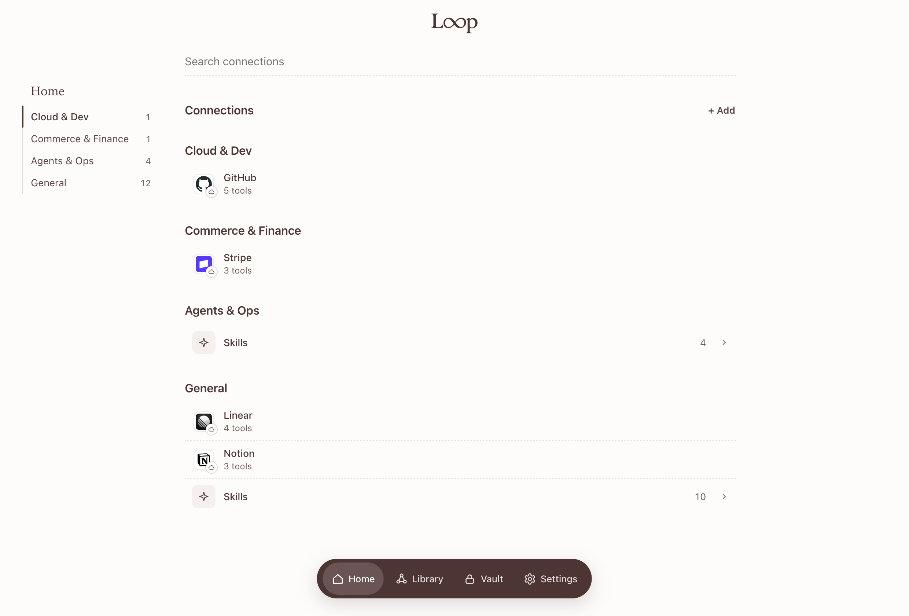
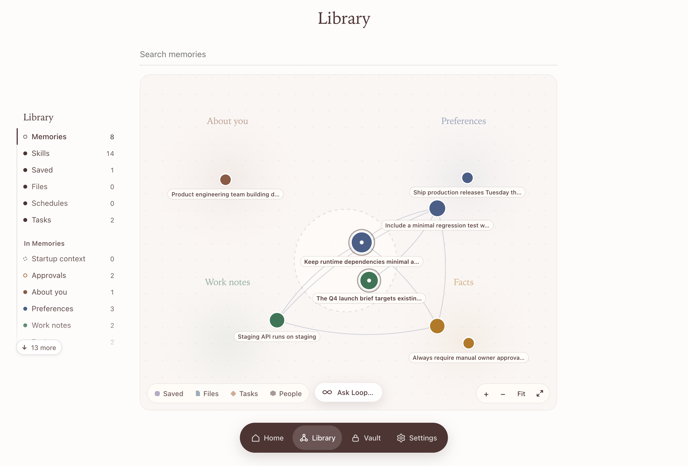
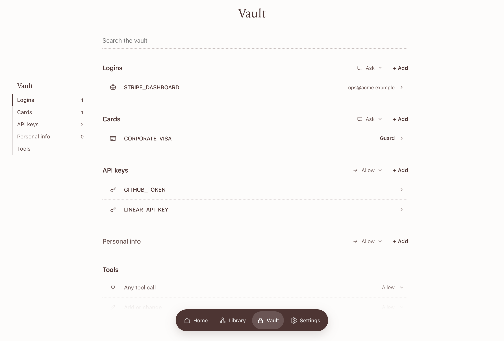
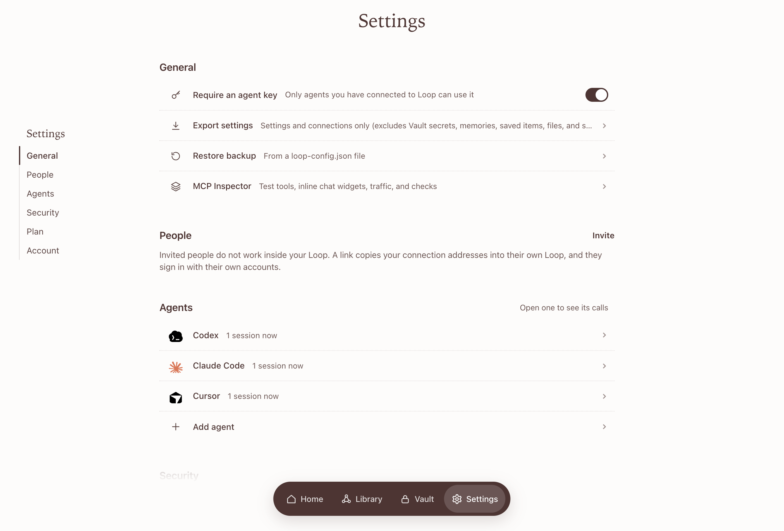

# Loop MCP Gateway

Loop keeps your Connections, Skills, Memory, accounts, and secrets in one place and lets **any agent** use them: Claude Code, Claude Desktop, Codex, Cursor, Antigravity, Muse, Grok Bot, OpenBot bots, and more. Import what your agents already have, give each agent its own key and permissions, and see what each one did.

Loop runs locally on loopback (`127.0.0.1`) or as a hosted multi-user deployment, aggregates upstream **tools**, **resources**, and **prompts** from Streamable HTTP, SSE, and local `stdio` MCP servers, encrypts credentials in a Vault, and manages everything through a web dashboard (**Home**, **Library**, **Vault**, and **Settings**).



| Library (Memories, Skills, Saved, Tasks) | Vault (Encrypted Secrets & Approvals) | Settings (Agents, People & Security) |
| --- | --- | --- |
|  |  |  |

## Quick Start (Free Local Loop)

Requires **Node.js 22.13+**. Local Loop runs 100% locally on `127.0.0.1:8799` with local password protection, unlimited MCP connections, and unlimited local agents—it never connects to live Loop (`useloop.sh`) unless you explicitly pair it via **Loop Connect** or run `loop update`.

**Install or update with one command (macOS / Linux):**

```sh
curl -fsSL https://useloop.sh/install.sh | sh
loop start
```

Or run from a git checkout:

```sh
npm install
npm start
```

**Update later (explicit, SHA-256 verified, with rollback):**

```sh
loop check                 # check for a newer release
loop update                # download, verify SHA-256, smoke-test, swap, and restart
loop rollback              # switch back to the previous release
```

**Hosted agents (`useloop.sh`) — refresh local `loop` skill and SessionStart hook with no new sign-in:**

```sh
curl -fsSL https://useloop.sh/connect.mjs | node - --update
```

On macOS, you can also run `./start.command` (or double-click it) to start Loop and open the dashboard automatically. Set `LOOP_NO_OPEN=1` to skip opening the browser.

Open the dashboard at **http://127.0.0.1:8799/**.

If you run Loop as a macOS launchd service (`local.loop-gateway`), run `npm restart` from this directory to load local updates. The command waits for Loop to report healthy. Reconnect open agents if the update changes the available tools.

### User sign-in & hosted workspaces

Users open Loop, sign up or sign in, and land in their own workspace. End users do not need a Clerk dashboard account, API keys, an OAuth application, or a provider connection—Clerk handles authentication for Loop itself, while agent keys remain separate.

**Operator / self-hosting setup:** create a [Clerk](https://clerk.com) application and set its publishable key as `CLERK_PUBLISHABLE_KEY` in the server environment or in `.env.local` (see [`.env.example`](.env.example)). For a public multi-user deployment, use a Clerk production instance, a verified production domain, HTTPS, and `LOOP_HOSTED=1`. No Clerk secret key is needed for the running app. If the publishable key or the verification service is unavailable, private APIs stay locked.

A verified account starts with its own connections, agent keys, Vault, skills, memory, settings, and activity. A new user never inherits pre-existing local data on the host machine. To restore a previous local installation, sign in on the host machine to the account that should own it, then use **Settings → Restore this Mac's existing workspace** and confirm with the previous Loop password. This one-time operation assigns the original workspace to that identity without moving its files. Restore before storing data in your new personal workspace. The Vault password protects showing saved values; it is not a second sign-in system.

Host discovery, local executables (`Local` / `stdio` commands), and host-import operations are available only in the restored device workspace. Hosted personal workspaces keep their own agent endpoint, allow **any public HTTPS MCP server (port 443)** by default while blocking private/internal network addresses and Loop itself, and support **Import JSON** for Cloud connections. Server operators can lock personal workspaces down to an explicit origin allowlist with `LOOP_TRUSTED_MCP_ORIGINS`. Every agent request needs that workspace's Loop agent key; user accounts are never authorization to run arbitrary programs on the server.

### Environment Variables

| Variable | Default | Description |
| --- | --- | --- |
| `CLERK_PUBLISHABLE_KEY` | `.env.local` | Loop app publishable key. Never put a Clerk secret key in client configuration. |
| `LOOP_HOSTED` | (unset) | Set to `1` to explicitly mark a deployment as hosted (disables local-device workspace detection, host discovery, and local command connections). |
| `LOOP_TRUSTED_MCP_ORIGINS` | (unset — any public HTTPS origin on port 443) | Optional comma-separated allowlist of public HTTPS origins (`https://host`) to restrict hosted personal workspaces instead of allowing any public HTTPS MCP server. |
| `LOOP_HUB_PORT` | `8799` | Local port for the web UI and `/mcp` gateway. |
| `LOOP_HUB_DATA` | macOS: `~/Library/Application Support/Loop Hub`<br>Linux: `$XDG_DATA_HOME/loop-hub` (or `~/.local/share/loop-hub`) | Directory storing `config.json`, `vault.json`, `vault.key` and `activity.jsonl` (owner-only permissions). |
| `LOOP_AGENT_HOOKS` | (unset) | Set to `1` to have Loop add its "check Loop first" hook and link its `loop` skill in every installed Claude Code and Codex at startup, including ones installed later. Unset, startup only refreshes the hook where you already installed it. |
| `LOOP_NO_AGENT_HOOKS` | (unset) | Set to `1` to stop Loop touching agent hooks at startup at all. |
| `LOOP_AGENT_FEEDBACK` | (unset) | `off` takes `loop__send_feedback` away from all agents of this server. Otherwise each owner decides, in Settings or through an agent. On a server where other people have a Loop (`LOOP_PUBLIC_ORIGIN` or `LOOP_HUB_ALLOWED_HOSTS`), agents ask the owner before the first report. |
| `LOOP_HUB_ALLOWED_HOSTS` | (none) | Extra `host:port` values Loop answers to, comma-separated (for example a Tailscale name). By default only `127.0.0.1`, `localhost` and `[::1]` on Loop's port are accepted. |

## Connecting Agents

Every agent gets **its own identity** in Loop, so you can see what each one did and choose what each one may use. There are two ways to give an agent one:

- **Let the agent sign in (simplest).** Add Loop's address to the agent with no key. The agent opens Loop in your browser, you approve it once, and it gets its own identity in Loop with no key to copy (OAuth 2.1).
- **Create a key yourself.** Open the dashboard's **Agents** tab, add the agent (name, kind, which project it can use, shared Memory access, whether it may manage connections, and which Vault secrets it may read), then press **Connect** to copy a ready-made setup that already contains its key. Keys look like `loop_…`, are stored as a hash plus an encrypted copy in the Vault, and can be replaced at any time with **New key**.

The **Agents** tab shows where each agent stands. An agent that has Loop in its settings but never got in shows **Never connected** or **Sign-in not finished**, with the step that finishes it.

### Claude Code

```sh
claude mcp add --transport http --scope user loop http://127.0.0.1:8799/mcp
```

Then open `/mcp` in Claude Code, pick **loop** and choose **Authenticate**. `--scope user` adds Loop for every project; without it Claude Code adds Loop to the current folder only. To use a key you created instead, add `--header "Authorization: Bearer loop_…"` to the command.

### Codex

```sh
codex mcp add loop --url http://127.0.0.1:8799/mcp
codex mcp login loop
```

To use a key you created instead, put it in `~/.codex/config.toml`:

```toml
[mcp_servers.loop]
url = "http://127.0.0.1:8799/mcp"
http_headers = { Authorization = "Bearer loop_…" }
```

### Make agents check Loop first (Claude Code and Codex)

Other plugins can inject "prefer me" instructions into every session. To make Loop the default for connected accounts and external services, install Loop's agent hook and skill. They are off until you turn them on: Loop never edits another tool's settings on its own. Once installed, Loop refreshes it each time the server starts (for example after Node moves), only in the agents that already have it. To also cover agents you install later, set `LOOP_AGENT_HOOKS=1`; to stop Loop touching hooks at startup, set `LOOP_NO_AGENT_HOOKS=1`.

```sh
npm run hooks -- install     # turn the hook on (or refresh it) and link the loop skill, in every installed agent
npm run hooks -- status      # show where they are installed
npm run hooks -- uninstall   # remove only Loop's entries and Loop's own skill link
```

This adds a `SessionStart` entry to `~/.claude/settings.json` and `~/.codex/hooks.json`, leaving other hooks untouched, cleaning up any legacy Loop `UserPromptSubmit` entries, and saving the previous file as `<file>.before-loop-hooks`. It also links Loop's `loop` skill into each agent's skills folder (`~/.claude/skills/loop`, `~/.codex/skills/loop`): a folder or link that is already there is left alone, `--no-skill` skips the skill, and starting Loop only repairs a link that broke (it adds one only with `LOOP_AGENT_HOOKS=1`).

On session start the hook emits a short stateless reminder telling the agent to use its built-in tools first, query Loop with `loop__search` when needed, follow the `loop` skill for scenario workflows, and show one-line connect instructions if Loop tools are missing. It reads no local `config.json`, makes no network calls, never lists connection names, and works identically for Local Loop, Hosted Cloud, and every profile (all scoping stays silently on the Loop MCP server). Codex asks you to review new hooks the next time it starts, and needs `hooks = true` under `[features]` in `config.toml`.

### Connect a hosted bot

In Loop, open **Agents → Add agent** and choose your host. Use the public HTTPS MCP address shown for your Loop workspace. For Loop Cloud this is normally `https://useloop.sh/mcp`. A remote bot needs an address it can reach from its own network.

| Host | Where to add Loop |
| --- | --- |
| Grok Bot | Open the prefilled message from Loop, or choose **Connect apps → Add a custom connector → Remote HTTPS**. A connection is available to the Bots on that Grok account. |
| Claude Duet | Add Loop in **Claude → Customize → Connectors** and choose **Register automatically** when asked. Duet uses the connectors on that Claude account. |
| Meta Muse | Copy the setup prompt into Muse and request private browser sign-in. **Muse Code** has its own CLI setup. |
| OpenMausBot | Open **Plugins → MCP servers → Add server**, enter your Loop `/mcp` address, and sign in with OAuth. |
| CopilotKit OpenBot | Open **Connections → Add custom MCP**, enter the address and complete personal sign-in. Then grant the connection to the intended Bot. |

At Loop consent, choose **Share one connection**, select the account by label, and select the actions to share. Each selected action is exposed as a named tool. New tools require a new grant. **Whole connection** also grants its future enabled tools. A provider that offers one tool for running many operations gives that tool the powers of its underlying account. Choose concrete tools when you need a narrower grant.

Each host authorizes its own access to Loop and can reuse an already connected provider account. After sign-in, ask the host to perform a read you selected. To change the actions later, reconnect Loop in that host and choose **Change shared actions** on the consent screen. Changing the selection signs out older sessions for that grant. To withdraw access, disable the agent in Loop. Clients that support OAuth token revocation can also release their issued token when disconnecting.

### Cursor, Antigravity and other JSON configs

```json
{
  "mcpServers": {
    "loop": {
      "url": "http://127.0.0.1:8799/mcp",
      "headers": { "Authorization": "Bearer loop_…" }
    }
  }
}
```

### Stdio Bridge (`stdio.mjs`)

For MCP clients that only support `stdio` servers (pass the key in the environment, not on the command line):

```json
{
  "mcpServers": {
    "loop": {
      "command": "node",
      "args": ["/absolute/path/to/loop/stdio.mjs"],
      "env": {
        "LOOP_HUB_URL": "http://127.0.0.1:8799/mcp",
        "LOOP_HUB_TOKEN": "loop_…"
      }
    }
  }
}
```

`stdio.mjs` accepts `--profile <name>`, `--url <endpoint>` and `--token <key>` (or `LOOP_HUB_PROFILE`, `LOOP_HUB_URL` / `LOOP_HUB_PORT`, `LOOP_HUB_TOKEN`).

### Agent keys and older installs

New installs require an agent key on `/mcp`. Installs from before agent keys existed keep working without keys, and Home shows a warning until you add your agents and turn on **Settings → Require an agent key**.

### System skills

On **Home → System**, local users see five operating guides: Loop, Connections, Skills, Organize, and Vault. Hosted and restricted sessions expose only the guides they can use. Request a native guide by its stable ID, for example `loop__inspect({ type: "skill", id: "system:vault" })`. A guide does not grant additional permissions.

When the user directly provides a reusable credential, use Vault capture to create a new entry without displaying its value. With no value supplied, request a secure form instead. Saving does not grant the agent access to use or share the credential. For category changes, preview first, then use the before/after card on Home for the approval decision. Clients that cannot display cards still receive text.

### Per-client projects

An owner profile selects a project context: its local working folder, saved tasks, memories, and favorite tools. **All** is the account-wide view. To start an authorized owner session focused on Work, use `/mcp?project=work`. This does not change existing grants.

Append `?profile=work` to `/mcp` to narrow an agent to that project. An agent restricted to one project cannot widen its access. All clients use the same discovery interface. Existing `?mode=` settings and bridge mode flags are accepted for compatibility and have no effect.

### Using Loop Cloud on a paired computer

Pair the computer in Settings → Plan, then open **Add Agent** on that computer. Select your agents and approve their access in Loop Cloud. Loop writes the hosted `/mcp` address and each approved agent’s own key to its configuration. Restart an open agent to use the new configuration. Run Add Agent again for agents previously connected to localhost.

Connected agents read and edit the same cloud workspace. A successful Memory write is immediately available to other authorized agents. Pairing publishes local tool setups and availability. Existing standalone data stays on its computer. The former workspace sync endpoints return an upgrade message.

Under **Saved local tools**, click **Install** on the computer where you want the tool to run. The website asks you to identify this computer once. Loop verifies the new installation by starting the tool and reading its capabilities. The original computer can be offline. A machine-specific script needs a portable package or install setup before it can be installed elsewhere.

## Features

Loop's dashboard manages your hub across Home, Agents, Connections, Skills, Library (memories, saved links and notes, files, and schedules), Vault, and Settings:

### Agents
- One entry per agent or bot, each with its own key, project, shared Memory access (`Read & save`, `Read`, or `None`), **Can manage connections** permission, and list of **shared Vault secrets**.
- **Connect** shows copy-ready setup for Claude Code, Codex, JSON configs, and the stdio bridge, with the agent's key filled in.
- **Agent OAuth 2.1 consent** lets MCP clients sign in directly: every authorization creates an isolated agent (never hijacking an existing agent by name), and the sign-in screen lets you choose what the agent can reach.
- **New key**, **Turn off**, and **Remove** take effect immediately.
- **Recent activity** lists tool calls, resource reads, prompt fetches, and secret use per agent (never the arguments), plus each time you view a secret.

### Home
- Live control panel with category filters, search, and per-connection switches, highlighting any Connection that needs sign-in, has a rejected token, or reported an error.
- **Approval banners** surface pending tool calls and actions with all request fields and referenced Vault secrets displayed in full (never truncating critical parameters).

### Vault
- Secret store encrypted at rest with **AES-256-GCM** using a 32-byte owner-only key (`vault.key`, mode `0600`) alongside `vault.json` (`0600`), organized by type (`API Key`, `Login`, `Payment`, `Note`).
- **Approval rules live here, in three modes.** **Allow**: agents use it and Loop keeps a log. **Ask**: you say yes in the chat, by text, or in Loop. **Guard**: you confirm on the Loop page with your Loop password, one time per use; a chat card, a text message, or an agent's own app cannot answer it. Each section heading shows the rule for its kind, an item can have a rule of its own, and the **Tools** section holds the rules for tool calls and for changes to Loop itself. When a tool and a Vault item have different rules, the stricter one wins. It takes the Loop password to take anything off Guard.
- **What asks from the start**: a payment card or a login from the Vault, deletes of saved items, a program added on your computer, a changed Connection address, category moves, and cleanup of another agent's setup. Tools run without asking by default. You can have Loop ask (or Guard) before a tool that says it can delete or overwrite, a tool that carries no safety label, or a tool that adds or changes things, judged from each tool's own MCP annotations and never from a list of names. On an Ask, **Approve & Always Allow** stops the question for that tool and **Always allow all of …** for its whole connection; a card, a login, and Guard have no such choice. An agent may take back a memory, task or Skill that it saved in the last hour and that nobody changed since. A delete of several items is one request that lists them all. One connection or one tool can have its own rule in its Connection panel.
- Reference stored secrets in any connection's HTTP headers or `stdio` environment variables using `{{vault:KEY}}` (for example, `Authorization: Bearer {{vault:GITHUB_TOKEN}}`). Placeholders are resolved only when Loop connects upstream and are never returned to MCP clients or config exports. Internal Loop keys (`__*`) are isolated from placeholder resolution, and external/pasted configs cannot reference already-saved Vault secrets.
- Plaintext keys entered in headers, `env`, `args`, or URL query/path/userinfo move into the encrypted Vault automatically, with transactional rollback if saving fails.
- **Agents never see secret values.** An agent gets only the names of secrets shared with it and writes `{{vault:KEY}}` inside tool arguments; Loop fills in the value just before calling the upstream tool, refuses keys that were not shared, and redacts any copy of a sent secret (including OAuth tokens and encoded/escaped variants) across tool results, resources, prompts, errors, and logs before reaching agents or disk.
- **Viewing a value takes your Loop password**, typed again even when you are already signed in. The value hides after 30 seconds and every view is logged. `loop__search({ type: "vault" })` gives agents `viewInLoop` links so they can send you to the right secret instead of asking for it.
- Tracks active OAuth token status and expiration for OAuth-authenticated connections.

### Connections
- **Probe-first Add Connection flow**: Paste a Server URL (plus optional Name; transport, bearer token, extra headers, projects, and description live under **Advanced**, and `Local (Command)` is hidden in hosted accounts). Loop probes the URL first without sending any keys, then goes straight to OAuth sign-in, an API key box, "Connected", or a redirect confirmation prompt.
- **Multi-transport support**: Connect **Cloud** servers over Streamable HTTP (with automatic SSE fallback) or SSE, and **Local** `stdio` MCP servers in local device workspaces.
- **OAuth 2.1**: One-click sign-in supporting RFC 9728 Protected Resource Metadata, RFC 8414 Authorization Server discovery, RFC 8707 resource indicators, RFC 9207 issuer verification, PKCE (`S256`), Dynamic Client Registration (DCR), encrypted token storage, and automatic token refresh.
- **Hosted & local Import JSON**: Paste `mcp_config.json` / `mcpServers` JSON in both local and hosted workspaces. Hosted Import JSON imports public HTTPS servers, skips local commands, never reads server environment variables, moves keys into the encrypted Vault, and shows a summary listing any skipped servers or dropped unusable settings.
- **Import from your agents (local device workspace)**: Discover user-added Connections and Skills from Claude Code, Claude Desktop, Codex, Cursor, Antigravity, Gemini CLI, VS Code, Windsurf, OpenCode, and Zed without touching their native built-ins. Passwords, tokens, and keys found in env vars, headers, URLs, and arguments move into the Vault as `{{vault:KEY}}` placeholders.
- **MCP Tool Annotations & Automatic Sync**: Upstream tool annotations (`readOnlyHint`, `destructiveHint`, `idempotentHint`, `openWorldHint`) are preserved and passed through to agents, with an automatic one-time re-sync for existing connections.
- **Granular control & Tool Tester**: Organize servers with categories and project tags, toggle individual connections or **per-tool switches**, and test any tool directly from the dashboard.

### Settings
- **Backup & Export**: Downloads `loop-config.json` via `/api/export` with settings and connection definitions (raw Vault secrets are excluded).

## Security

- **Authentication & request guard**: The app verifies short-lived Clerk session JWTs against its own issuer and public keys, checks the intended origin, and scopes private data by issuer and user ID. Existing local password cookies cannot grant dashboard access. Live event streams are workspace-scoped and end when their proof expires. Locally, Loop listens on `127.0.0.1`, refuses unexpected `Host` headers (blocking DNS rebinding), and blocks cross-site browser requests (`Origin` / `Sec-Fetch-Site`).
- **Destination-bound credentials & approval-gated changes**: Credentials are bound to the connection's destination (origin for HTTP/SSE, command/args/cwd for stdio). Creating local `stdio` connections or changing a connection's destination by an agent requires explicit owner approval; repointing a connection re-checks agent secret grants and never forwards OAuth tokens to a new origin.
- **Vault isolation & automatic extraction**: External or pasted configs cannot reference saved Vault secrets (`{{vault:...}}`), and internal Loop keys (`__*`) are isolated from placeholder resolution. Plaintext keys entered in headers, `env`, `args`, or URL query/path/userinfo move into the encrypted Vault automatically with rollback on save failure.
- **Comprehensive secret redaction**: Sent secrets — including OAuth tokens and URL-encoded, base64, or escaped copies — are redacted across tool results, resources, prompts, errors, and logs before reaching agents or disk.
- **Hardened upstream OAuth**: Upstream OAuth sign-in refuses Loop itself as well as private/internal and cross-port pivots, verifies authorization server identity at every step (RFC 9728, RFC 8414, RFC 8707, RFC 9207), and skips confirmation only on a fresh same-origin **Connect** click (always confirming cross-origin or agent-supplied sign-in links).
- **Isolated agent OAuth & full approval visibility**: Agent OAuth consent always creates an isolated agent (never hijacking an existing agent by name). Approval banners prominently display the full destination alongside all request fields and referenced Vault secrets without truncating critical parameters.
- **Hosted outbound policy**: Hosted personal workspaces allow any public HTTPS MCP server on port 443 by default while blocking private/internal IP ranges, local hostnames, redirects, and Loop itself at connection time. Operators can restrict allowed origins via `LOOP_TRUSTED_MCP_ORIGINS` and enforce hosted mode via `LOOP_HOSTED=1`.
- **Agent key boundary & minimal `stdio` environment**: Agent keys scope what each agent sees and does. Locally, agent keys are a permission and audit boundary, not a sandbox against same-OS-user shell access; for remote bots and hosted workspaces, keys are the enforcement boundary. Creating local `stdio` connections or changing connection destinations by an agent requires explicit owner approval, and local `stdio` child processes receive a minimal default environment (plus explicitly configured connection `env`) instead of Loop's full `process.env`.

## Built-in `loop__*` MCP Tools

Loop exposes three discovery and execution tools on `/mcp`, and `loop__send_feedback` while feedback is on. Agents with write access also receive `loop__save`.

| Tool | Description |
| --- | --- |
| `loop__search` | Read-only search across Connections (`type: "connections"`), tools (`type: "tools"`), Skills (`type: "skills"`), Memory (`type: "memory"`), Vault metadata (`type: "vault"`, never raw values), Categories (`type: "categories"`), or an overview (`type: "all"`). `queries` looks up several things in one call. Results are short rows: a query also returns the `inputSchema` of its best three tools and the `SKILL.md` of one or two clear Skills, and `loop__inspect` returns the rest. `type: "tools"` groups shared connection/category info once in `connections` alongside compact ranked `tools`. |
| `loop__inspect` | Inspect full details (`inputSchema`, annotations, description, approval policy, skill `SKILL.md`, connection details, or memory card) for a single `id` or a batch via `ids: [...]` (up to 20 items in one call). An item can be named by its id or by a display name that only it has; `type: "project"` with an `id` shows what a project holds. |
| `loop__run` | Execute one namespaced upstream tool (`<connection_id>__<tool_name>`) with `arguments`, or a batch of up to 10 upstream calls in order via `calls: [{ tool, arguments }, ...]`, resolving `{{vault:KEY}}` placeholders, redacting secrets, enforcing approval policies per call, and running pre-flight input validation (checks required inputs & types before calling upstream and returns missing/invalid fields + `inputSchema` in one step). |
| `loop__save` | Save, update, sync, organize, or delete Connections, Skills, Projects, Memory, Tasks, Vault items, or Categories (listed only for agents with write/manage permissions). `ids: [...]` deletes up to 50 memories, tasks, Skills or Connections in one call. |
| `loop__send_feedback` | Report a problem with Loop itself, or a missing capability, to the people who run this Loop. On your own computer the reports stay there. On a public server the agent asks the owner first. The owner sees and deletes the reports in Settings → Security, and turns them on or off there or through an agent: `loop__save({ type: "feedback", data: { enabled } })`. See [`docs/agent-feedback.md`](docs/agent-feedback.md). |

Pre-flight input validation and secret redaction apply equally to direct `<connection_id>__<tool_name>` calls and `loop__run` calls.

## Running Tests

```sh
npm test
```

Runs `node --test test/*.test.mjs` across the gateway, MCP protocol, OAuth, `stdio.mjs`, Vault, Store, agents, request guard, outbound policy, tool validation, hooks, and import test suites.

## Plans & Pricing (Local Loop vs. Loop Connect)

Both **Loop (Local)** and **Loop Connect** (`useloop.sh`) use the same **Home**, **Library**, **Vault**, and **Settings** dashboard. Loop's local gateway, encrypted Vault, per-agent keys, approvals, Skills, and Library are **100% free and open source under AGPL-3.0** on 1 local computer—with unlimited connections and unlimited local agents, and zero connection to live Loop (`useloop.sh`). **Loop Connect** unlocks live Loop Cloud plus multi-device sharing across up to 2 connected devices.

| Plan | Price | What's Included |
| --- | --- | --- |
| **Loop (Local)** | Free forever | 1 local device (`127.0.0.1`), local-only (never connects to `useloop.sh`), unlimited `stdio` & remote MCP connections, unlimited local agents on that computer, encrypted Vault, approvals, Skills, Memory, and agent hooks. |
| **Loop Connect** | $12 / mo *(+$5 / extra device)* | Unlocks live Loop Cloud (`useloop.sh`), **2 connected devices included** (+$5/mo per additional device) sharing all your Loop connections (including live local `stdio` relay), unlimited connections & agents, SMS/iMessage agent, project sharing, 30-day activity history. |
| **Loop Team** *(Waitlist)* | $24 / seat / mo | Shared team Vaults, Connections & Projects, unlimited devices, org-wide approval policies & RBAC, instant offboarding, 365-day audit logs. |
| **Enterprise & Commercial** *(Waitlist)* | Custom | SSO/SAML/SCIM, SIEM export, BYOK/KMS Vault encryption, unlimited devices, and commercial (non-AGPL) licensing. |

## Contributing

Contributions are welcome! See [CONTRIBUTING.md](CONTRIBUTING.md) for local setup, architecture notes, testing instructions, and pull request guidelines. Please review our [Code of Conduct](CODE_OF_CONDUCT.md) before participating.

## License

Loop is open-source software licensed under the [GNU Affero General Public License v3.0](LICENSE) (`AGPL-3.0-only`). You are free to use, modify, and self-host it. If you run a modified version of Loop as a network service for others, you must make your modified source code available under the AGPL-3.0 license. Outside contributors sign our [Contributor License Agreement](CLA.md). Third-party bundled libraries, icons, and trademark notices are listed in [THIRD_PARTY_NOTICES.md](THIRD_PARTY_NOTICES.md).

For hosted plans (`Loop Connect`) or commercial licensing inquiries (without AGPL-3.0 obligations), visit [useloop.sh](https://useloop.sh). To report a security vulnerability, see [SECURITY.md](SECURITY.md).

### Work in a project folder

For an account-wide management session, selecting a project sets context without removing authorized tools. Project favorites rank first among comparable matches. Project-limited links and agent grants remain strict.

Link a named project to its checkout on this device. Entering the project gives a local agent the working directory for file operations; it does not change the parent terminal or grant filesystem access. A local agent can ask for the link with `loop__save({ type: "project", data: { name, workingDirectory } })`; you confirm the folder before Loop keeps it. If the checkout is unavailable, Loop reports that instead of choosing another directory.

To start a local process directly in the linked checkout, run `npm run project:exec -- <project-id> -- <command> [args...]` from the Loop installation. For example, `npm run project:exec -- loop -- npm test` runs the selected checkout's tests. The launcher records the run under the project, without its arguments or output. Enter that project and use `loop__search({ type: "tasks" })` to find the run or previously saved tasks. An external client's chats are not imported.
